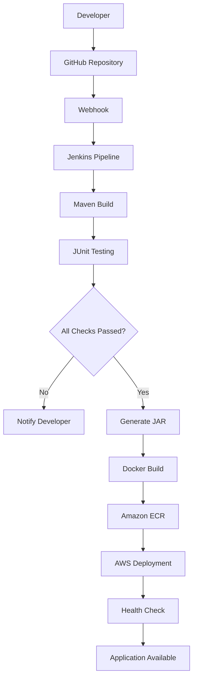

# 🚀 Top 50 Jenkins Interview Questions and Answers

**Target Role:** Java Backend Developer / Software Engineer  
**Level:** Beginner to Advanced  
**Technology Stack:** Java, Spring Boot, Git, GitHub, Maven, Jenkins, Docker and AWS.

This document contains 50 important Jenkins interview questions with simple, practical answers. The examples focus on how Jenkins is used in real-world Java backend development.

---

# Section 1: Jenkins Fundamentals (1–15)

### 1. What is Jenkins?

Jenkins is an open-source automation server used for Continuous Integration and Continuous Delivery/Deployment (CI/CD).

It automates software development activities such as building applications, running automated tests, performing quality checks and deploying applications.

For example, when a developer pushes Java code to GitHub, Jenkins can automatically detect the changes, build the Spring Boot application using Maven and execute JUnit test cases.

### 2. Why do we use Jenkins?

We use Jenkins to automate repetitive software development activities.

Its major advantages are:

- Automates application builds.
- Executes automated test cases.
- Detects errors early.
- Integrates with GitHub.
- Automates deployment.
- Reduces manual effort.
- Improves software delivery speed.

### 3. What is CI/CD?

CI/CD represents Continuous Integration and Continuous Delivery or Continuous Deployment.

- CI: Automatically builds and tests code changes.
- Continuous Delivery: Keeps the application ready for release, generally requiring manual production approval.
- Continuous Deployment: Automatically deploys changes to production after all required checks pass.

### 4. What is the difference between Continuous Integration, Continuous Delivery and Continuous Deployment?

**Continuous Integration:**
Developers frequently integrate their code into a shared repository. Automated builds and tests validate the changes.

**Continuous Delivery:**
The application is automatically built, tested and prepared for release. Production deployment generally requires manual approval.

**Continuous Deployment:**
Every change that passes the required automated checks is automatically deployed to production without manual production approval.

### 5. Is Jenkins a Version Control System?

No. Jenkins is not a Version Control System.

Git is a Distributed Version Control System used to track changes in source code.

Jenkins integrates with Git to automate application builds, testing and deployment.

### 6. What is the difference between Git and Jenkins?

| Git | Jenkins |
|---|---|
| Version Control System | Automation Server |
| Tracks code changes | Automates development workflows |
| Manages branches and commits | Executes pipelines |
| Supports merging | Automates builds and deployments |
| Works locally and remotely | Runs configured automation jobs |

### 7. What are the major features of Jenkins?

Major features include:

- Open-source automation.
- Pipeline support.
- Plugin ecosystem.
- GitHub integration.
- Distributed builds.
- Automated testing.
- Build scheduling.
- Deployment automation.
- Build notifications.

### 8. What is a Jenkins Job?

A Jenkins Job is a configured task that Jenkins executes.

For example, a job can:

- Clone a GitHub repository.
- Build a Java application.
- Run automated tests.
- Deploy an application.

### 9. What is a Jenkins Pipeline?

A Jenkins Pipeline is a sequence of automated stages used to build, test and deploy an application.

Example:

1. Checkout source code.
2. Build application using Maven.
3. Execute JUnit tests.
4. Package the application.
5. Deploy the application.

### 10. What is a Jenkins Plugin?

A Jenkins Plugin is an extension that adds additional functionality to Jenkins.

Examples:

- Git Plugin – Git repository integration.
- Pipeline Plugin – Pipeline creation and execution.
- Maven Integration Plugin – Maven-related integration.
- Docker Pipeline Plugin – Docker-related pipeline operations.

### 11. What are Jenkins Controller and Agent?

**Jenkins Controller:** The central Jenkins service responsible for managing jobs, scheduling builds and coordinating agents.

**Jenkins Agent:** A machine or execution environment that performs the tasks assigned by the controller.

### 12. What is the difference between Jenkins Controller and Agent?

| Controller | Agent |
|---|---|
| Manages Jenkins | Executes assigned tasks |
| Schedules builds | Runs builds |
| Manages configurations | Provides execution environment |
| Coordinates agents | Reports build results |

### 13. What is a Jenkins Workspace?

A Jenkins Workspace is a directory on an agent where Jenkins checks out source code and executes build operations.

For example, Jenkins can download a Spring Boot project into its workspace and execute Maven commands.

### 14. What is a Jenkins Build?

A Jenkins Build is an execution of a configured job or pipeline.

For example, when a developer pushes new code, Jenkins triggers a build that compiles the application and executes test cases.

A build can be successful, failed, unstable or aborted, depending on its result.

### 15. What are the prerequisites for installing Jenkins on Windows?

Common prerequisites include:

- Windows operating system.
- A supported Java version.
- Jenkins Windows MSI installer.
- Administrator permissions.
- Sufficient memory and disk space.

Jenkins versions have specific Java requirements, so the official installation documentation should be checked before installation.

Official website: https://www.jenkins.io/download/

---

# Section 2: GitHub and Jenkins Integration (16–25)

### 16. How does Jenkins integrate with GitHub?

Jenkins integrates with GitHub using Git-related plugins and repository configuration.

The general process is:

1. Configure the GitHub repository URL in Jenkins.
2. Configure credentials if required.
3. Configure a Webhook or Periodic Polling.
4. Create a Jenkins Pipeline.
5. Push code to GitHub.
6. Jenkins detects the changes and triggers the configured pipeline.

### 17. How does Jenkins detect changes in a GitHub repository?

Jenkins commonly detects repository changes using:

1. Webhooks.
2. Periodic Polling.

Webhooks provide event-driven notifications from GitHub, while Periodic Polling checks the repository at configured intervals.

### 18. What is a Webhook?

A Webhook is an automatic HTTP notification sent from one application to another when a specific event occurs.

For example, when a developer pushes code to GitHub, GitHub sends an HTTP POST request to the configured Jenkins webhook endpoint.

Jenkins receives the notification and triggers the configured pipeline.

### 19. How does a GitHub Webhook trigger a Jenkins pipeline?

The process is:

1. Developer pushes code to GitHub.
2. GitHub detects the push event.
3. GitHub sends an HTTP POST request to Jenkins.
4. Jenkins receives the notification.
5. Jenkins triggers the configured pipeline.
6. Jenkins checks out the latest code.
7. The build and test stages execute.

### 20. What is Periodic Polling in Jenkins?

Periodic Polling is a mechanism where Jenkins checks a GitHub repository at predefined time intervals to identify new changes.

For example, if Jenkins is configured to check every five minutes, it checks the repository again after the next scheduled interval.

If new changes are detected, Jenkins can trigger the configured build.

### 21. What is the difference between Webhook and Periodic Polling?

| Webhook | Periodic Polling |
|---|---|
| Event-driven | Time-driven |
| GitHub initiates notification | Jenkins checks GitHub |
| Near real-time | Depends on configured interval |
| Usually fewer unnecessary checks | Repeated repository checks |
| Requires reachable webhook endpoint | Requires Jenkins to access repository |

### 22. What happens if a developer pushes code to GitHub but Jenkins does not trigger the pipeline?

I would troubleshoot the following:

1. Check whether the webhook URL is configured correctly.
2. Check recent webhook delivery responses in GitHub.
3. Verify Jenkins connectivity.
4. Check the Jenkins job trigger configuration.
5. Verify repository permissions and credentials.
6. Check Jenkins logs and build history.

If polling is configured, I would also verify its schedule and polling logs.

### 23. What is the purpose of the Git Plugin in Jenkins?

The Git Plugin allows Jenkins to interact with Git repositories.

It helps Jenkins:

- Clone repositories.
- Fetch source code.
- Check out branches.
- Retrieve commits.
- Work with repository revisions.

### 24. How does Jenkins authenticate with a private GitHub repository?

Jenkins can authenticate using configured credentials such as:

- Personal Access Tokens.
- SSH private keys.
- Supported username and password-based credentials.

These credentials should be stored securely in the Jenkins Credentials Store instead of hardcoding them in pipeline scripts.

### 25. How do you configure Jenkins to automatically trigger a build whenever code is pushed to GitHub?

The general steps are:

1. Configure the GitHub repository in Jenkins.
2. Install and configure the required plugins.
3. Enable the appropriate build trigger.
4. Configure a GitHub Webhook.
5. Enter the Jenkins webhook endpoint in GitHub.
6. Select Push events.
7. Save the configuration.
8. Push a new commit.
9. Verify whether Jenkins triggers the pipeline.

---

# Section 3: CI/CD and Jenkins Pipelines (26–35)

### 26. What happens internally when a developer pushes code into GitHub and Jenkins starts a CI pipeline?

The process is:

1. Developer writes and commits code.
2. Developer pushes the code to GitHub.
3. Jenkins detects the changes through a Webhook or Polling.
4. Jenkins checks out the latest source code.
5. Maven compiles and builds the application.
6. Jenkins executes automated test cases.
7. If required checks fail, the pipeline reports failure.
8. If checks pass, the changes can proceed through code review and merge.
9. The pipeline reports the build result.

### 27. What are the different stages of a typical Jenkins CI pipeline?

Common stages include:

- Checkout: Retrieves source code.
- Build: Compiles the application.
- Test: Executes automated tests.
- Code Quality: Performs static analysis.
- Package: Generates JAR or WAR files.
- Publish: Stores the generated artifacts.

Deployment can be included in a broader CI/CD pipeline.

### 28. What is a Jenkinsfile?

A Jenkinsfile is a text file that contains the instructions for a Jenkins Pipeline.

It defines:

- Pipeline stages.
- Build commands.
- Test commands.
- Environment variables.
- Deployment steps.
- Post-build actions.

It is generally stored in the root directory of the source code repository.

### 29. What is the difference between Declarative Pipeline and Scripted Pipeline?

| Declarative Pipeline | Scripted Pipeline |
|---|---|
| Structured syntax | More flexible Groovy scripting |
| Easier to understand | Requires more scripting knowledge |
| Uses `pipeline {}` | Uses `node {}` |
| Provides predefined sections | Allows more programming flexibility |

### 30. What are Stages and Steps in Jenkins?

**Stage:** Represents a logical section of a pipeline.

Examples: Build, Test and Deploy.

**Step:** Represents an individual operation executed inside a stage.

Example:

```groovy
stage('Build') {
    steps {
        sh 'mvn clean compile'
    }
}
```

Here, Build is the stage and `mvn clean compile` is the step.

### 31. How does Jenkins use Maven to build a Spring Boot application?

Jenkins executes Maven commands as part of its pipeline.

For example:

```bash
mvn clean compile
mvn test
mvn package
```

- `clean`: Removes previous build output.
- `compile`: Compiles the source code.
- `test`: Executes test cases.
- `package`: Packages the application into a JAR or WAR file.

Maven also resolves the project's dependencies.

### 32. What happens if some JUnit test cases fail during the Jenkins pipeline?

Jenkins generally marks the pipeline as failed if a required test fails.

For example:

- Total test cases: 10.
- Passed: 8.
- Failed: 2.

The developer investigates the failed tests, fixes the issues and pushes updated code.

Jenkins then executes the pipeline again.

### 33. How does Jenkins notify developers when a build fails?

Jenkins can notify developers using configured notification integrations such as:

- Email.
- Slack.
- Microsoft Teams through supported integrations.
- Other notification services.

Notifications can be configured using pipeline post-actions and plugins.

### 34. What is the difference between a successful build and a successful deployment?

**Successful Build:**

The application has been compiled and packaged successfully.

For example, Maven generates `employee-management.jar`.

**Successful Deployment:**

The generated application has been successfully deployed to the target environment and is running as expected.

A successful build does not guarantee successful deployment.

### 35. How does Jenkins deploy a Spring Boot application to a production server?

A typical deployment process is:

1. Jenkins builds the Spring Boot application.
2. Maven generates an executable JAR.
3. The artifact is published or transferred to the target environment.
4. Jenkins executes configured deployment commands.
5. The application is started or updated on the production server.
6. Health checks verify the deployment.

Deployment can also use Docker images and container platforms.

---

# Section 4: Practical and Advanced Jenkins Questions (36–50)

### 36. What is the difference between a JAR file and a Docker image?

| JAR | Docker Image |
|---|---|
| Java application package | Container image |
| Contains compiled application code and resources | Contains application and its required runtime environment |
| Runs using a compatible Java runtime | Runs as a container |
| Generated through Maven | Commonly generated through Docker |

A Spring Boot JAR can be packaged inside a Docker image.

### 37. How does Jenkins integrate with Docker?

Jenkins can execute Docker commands through its agents and configured Docker integration.

A typical workflow is:

1. Jenkins checks out the code.
2. Maven builds the Spring Boot application.
3. Docker builds an image using a Dockerfile.
4. The image is tagged.
5. The image is pushed to a container registry.
6. The image is deployed to the target environment.

### 38. What is the role of Docker in a CI/CD pipeline?

Docker packages applications and their dependencies into containers.

Its advantages include:

- Consistent execution environments.
- Application isolation.
- Easier deployment.
- Portability.
- Simplified application distribution.

### 39. How do you configure environment variables in Jenkins?

Environment variables can be configured inside a Jenkinsfile using the `environment` block.

Example:

```groovy
pipeline {
    agent any

    environment {
        APP_NAME = 'EmployeeManagement'
    }

    stages {
        stage('Build') {
            steps {
                echo "Building ${APP_NAME}"
            }
        }
    }
}
```

Sensitive information should be stored using Jenkins credentials rather than ordinary environment variable declarations.

### 40. What are Jenkins Credentials, and how do you manage sensitive information?

Jenkins Credentials are used to securely store sensitive information such as:

- Passwords.
- API tokens.
- SSH private keys.
- Database credentials.

They can be stored in the Jenkins Credentials Store and accessed through appropriate credential bindings.

Sensitive information should never be hardcoded into source code or exposed in build logs.

### 41. How do you manage different environments such as Development, Testing, Staging and Production?

We can configure separate deployment stages and environment-specific configurations.

For example:

- Development: Used for developer testing.
- Testing: Used for functional and integration testing.
- Staging: Used for pre-production verification.
- Production: Used by actual end users.

Different credentials, configuration files and deployment targets should be managed securely for each environment.

### 42. What is a Jenkins Multibranch Pipeline?

A Multibranch Pipeline automatically discovers branches in a source code repository that contain a Jenkinsfile.

It can create and execute separate pipelines for different branches.

For example:

- main
- development
- feature/employee
- feature/leave

This helps teams validate changes independently.

### 43. What is the difference between Freestyle Project and Pipeline Project?

| Freestyle Project | Pipeline Project |
|---|---|
| Configured mainly through Jenkins UI | Defined using a Jenkinsfile |
| Suitable for simpler jobs | Suitable for complex workflows |
| Less pipeline-as-code support | Supports pipeline as code |
| More UI-based configuration | Version-controlled pipeline configuration |

### 44. What is a Jenkins Build Trigger?

A Build Trigger is a mechanism that starts a Jenkins job or pipeline.

Common triggers include:

- Webhook events.
- Periodic polling.
- Scheduled builds.
- Upstream job completion.
- Manual triggering.

### 45. How do you schedule a Jenkins job using cron expressions?

Jenkins uses cron-style syntax to schedule jobs.

Example:

```text
H/5 * * * *
```

This schedules the job approximately every five minutes.

Another example:

```text
H 9 * * 1-5
```

This schedules the job once on weekdays around 9 AM, using a hashed minute.

### 46. What is the purpose of the `post` block in a Jenkinsfile?

The `post` block defines actions that execute after pipeline or stage execution.

Common conditions include:

- `always`: Runs regardless of the result.
- `success`: Runs when the pipeline succeeds.
- `failure`: Runs when the pipeline fails.
- `unstable`: Runs when the pipeline is unstable.
- `cleanup`: Runs after other post conditions.

Example:

```groovy
post {
    success {
        echo 'Build completed successfully'
    }

    failure {
        echo 'Build failed'
    }

    always {
        echo 'Pipeline execution completed'
    }
}
```

### 47. How do you handle build failures in Jenkins?

I would:

1. Open the Jenkins build history.
2. Check the console output.
3. Identify the failed stage.
4. Investigate compilation errors or failed test cases.
5. Fix the issue in the source code or configuration.
6. Commit and push the changes.
7. Allow Jenkins to execute the pipeline again.
8. Verify that all required stages pass.

### 48. What could cause a Jenkins deployment to fail even after the application is built successfully?

Possible reasons include:

- Production server unavailable.
- Incorrect server configuration.
- Port conflicts.
- Database connectivity issues.
- Missing environment variables.
- Incorrect deployment credentials.
- Insufficient permissions.
- Docker image or container startup issues.
- Network connectivity problems.

I would inspect deployment logs and server logs to identify the actual cause.

### 49. How would you troubleshoot an application that works locally but fails after Jenkins deployment?

I would follow this approach:

1. Check application startup logs.
2. Verify Java and runtime versions.
3. Compare local and production configurations.
4. Check environment variables.
5. Verify database connectivity.
6. Check server ports and permissions.
7. Inspect Docker configuration if containers are used.
8. Verify application health after deployment.

I would identify the actual exception before making configuration changes.

### 50. How would you design a complete CI/CD pipeline for a Java Spring Boot application using GitHub, Jenkins, Maven, Docker and AWS?

I would design the pipeline as follows:

**Step 1: Source Code Management**

Developers write code and push changes to GitHub.

**Step 2: Trigger**

GitHub sends a Webhook notification to Jenkins.

**Step 3: Checkout**

Jenkins checks out the latest source code.

**Step 4: Build**

Jenkins uses Maven to compile the Spring Boot application.

**Step 5: Testing**

Jenkins executes JUnit unit tests and integration tests.

**Step 6: Code Quality**

The pipeline performs configured quality checks, such as static code analysis.

**Step 7: Package**

Maven generates an executable JAR file.

**Step 8: Docker Image**

Docker packages the JAR and its runtime environment into an image.

**Step 9: Image Publishing**

The image is pushed to a container registry such as Amazon ECR.

**Step 10: Deployment**

Jenkins deploys the application to the configured AWS environment, such as an EC2 instance or an appropriate container platform.

**Step 11: Verification**

Health checks verify whether the application is running correctly.

**Step 12: Notification**

Jenkins notifies the development team about the pipeline result.

### Example Architecture



This architecture automates the software delivery lifecycle and reduces manual intervention.

---

# 📌 Final Revision Checklist

Before attending a Java Backend Developer interview, make sure you can explain:

- [ ] Jenkins fundamentals.
- [ ] Git and GitHub integration.
- [ ] Webhook and Periodic Polling.
- [ ] Jenkins Controller and Agent.
- [ ] Jenkins Pipeline and Jenkinsfile.
- [ ] Maven build lifecycle.
- [ ] JUnit testing.
- [ ] Continuous Integration.
- [ ] Continuous Delivery.
- [ ] Continuous Deployment.
- [ ] Docker integration.
- [ ] Jenkins credentials.
- [ ] Deployment troubleshooting.
- [ ] CI/CD architecture for Spring Boot.

---

# 📚 Official Learning Resources

1. Jenkins Documentation: https://www.jenkins.io/doc/
2. Jenkins Pipeline: https://www.jenkins.io/doc/book/pipeline/
3. Jenkins GitHub: https://github.com/jenkinsci/jenkins
4. Maven Documentation: https://maven.apache.org/guides/
5. Docker Documentation: https://docs.docker.com/
6. GitHub Documentation: https://docs.github.com/

---

**Learning approach:** Understand the concept, implement it in a practical project, and then prepare to explain it during an interview.

*This document is part of my continuous learning journey toward becoming a skilled Java Backend Developer.*
