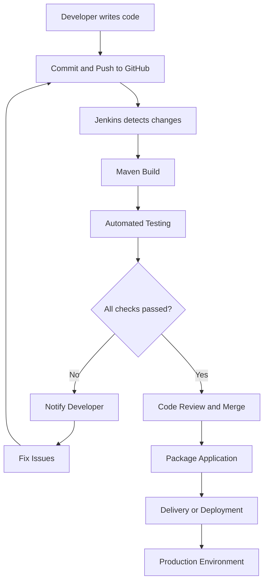
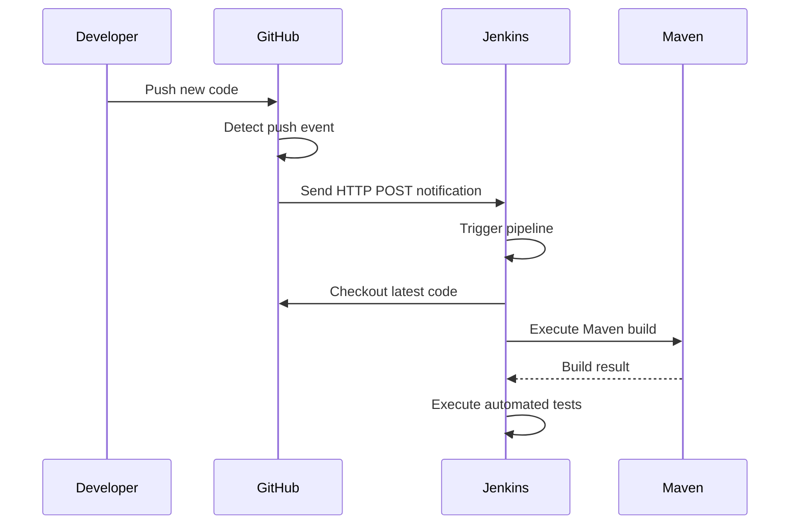
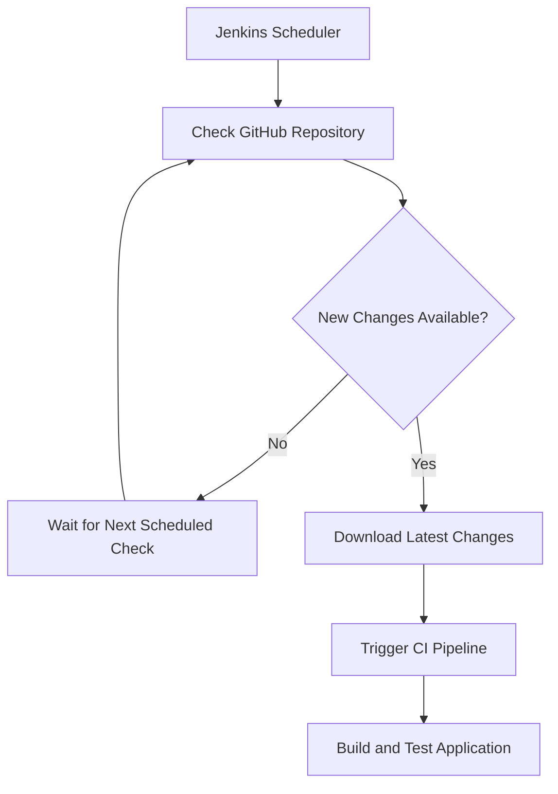
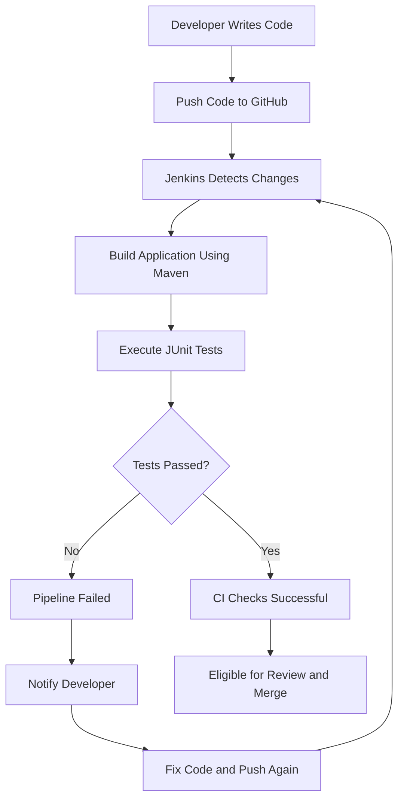
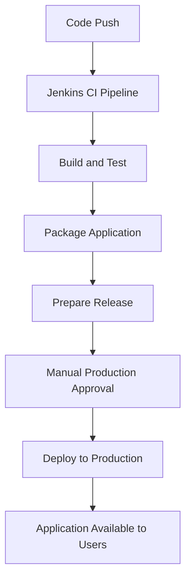
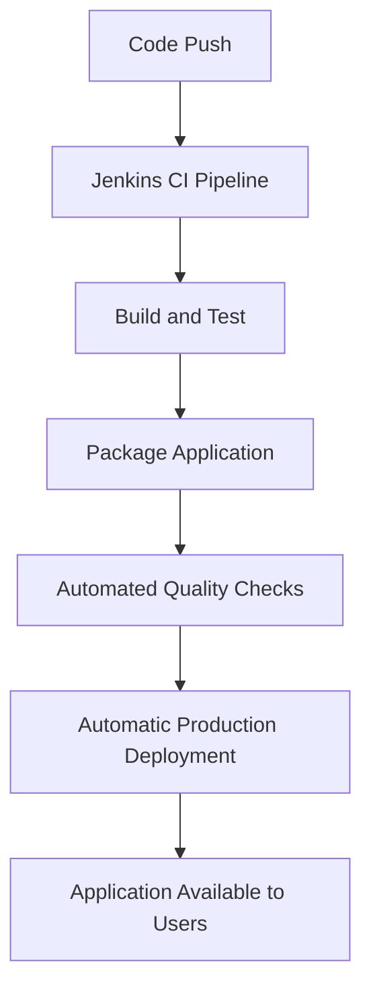
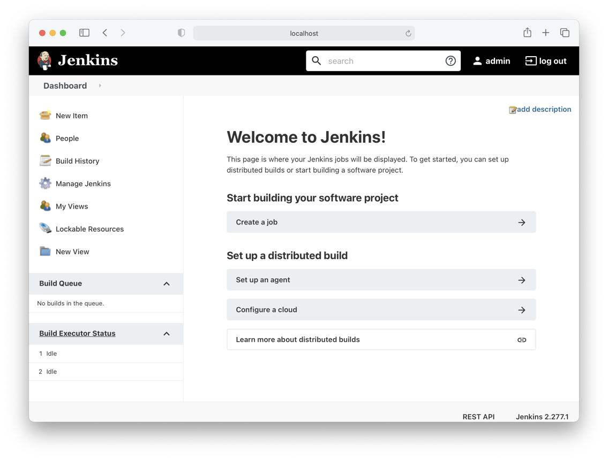

# 🚀 Jenkins – Learning CI/CD from Scratch


This repository documents my learning journey with **Jenkins**, an open-source automation server widely used for Continuous Integration (CI) and Continuous Delivery/Deployment (CD).

The objective of this repository is to understand how Jenkins works, how it integrates with GitHub, how automated pipelines are configured, and how applications are built, tested, and deployed.

I will be documenting concepts, workflows, diagrams, installation steps, practical examples, and troubleshooting techniques as I learn.

---

## 📚 Table of Contents

1. [Introduction to Jenkins](#-1-introduction-to-jenkins)
2. [Why Do We Use Jenkins?](#-2-why-do-we-use-jenkins)
3. [Jenkins Architecture and Workflow](#-3-jenkins-architecture-and-workflow)
4. [How Jenkins Detects Code Changes](#-4-how-jenkins-detects-code-changes)
5. [Webhook Mechanism](#-5-webhook-mechanism)
6. [Periodic Polling Mechanism](#-6-periodic-polling-mechanism)
7. [Webhook vs Periodic Polling](#-7-webhook-vs-periodic-polling)
8. [Understanding CI Pipeline](#-8-understanding-continuous-integration-ci)
9. [Understanding CD Pipeline](#-9-understanding-continuous-delivery-and-deployment)
10. [CI vs Continuous Delivery vs Continuous Deployment](#-10-ci-vs-continuous-delivery-vs-continuous-deployment)
11. [Installing Jenkins on Windows](#-11-installing-jenkins-on-windows)
12. [Integrating Jenkins with GitHub](#-12-integrating-jenkins-with-github)
13. [How to Verify Jenkins Integration](#-13-how-to-verify-jenkins-integration)
14. [Common Jenkins Problems](#-14-common-jenkins-problems)
15. [Important Jenkins Terms](#-15-important-jenkins-terms)
16. [Learning Resources](#-16-learning-resources)

---

# 🔹 1. Introduction to Jenkins

Jenkins is an open-source automation server used to automate software development activities such as:

- Building applications.
- Running automated test cases.
- Performing code quality checks.
- Packaging applications.
- Deploying applications to different environments.

In simple terms, Jenkins reduces repetitive manual work by automating the software development and delivery process.

For example, consider a Java Spring Boot application.

Whenever a developer pushes new code into GitHub, Jenkins can automatically detect the changes, build the application using Maven, execute test cases, and prepare the application for deployment.

---

# 🔹 2. Why Do We Use Jenkins?

Without Jenkins, developers may need to perform several activities manually whenever code changes.

For example:

1. Download or pull the latest code.
2. Compile the application.
3. Execute test cases.
4. Identify errors.
5. Package the application.
6. Deploy the application.

Jenkins automates these repetitive activities.

### Major advantages

- Automation of build and testing processes.
- Early identification of bugs.
- Faster software delivery.
- Integration with GitHub and other version control systems.
- Reduced manual intervention.
- Consistent software deployment.
- Support for multiple development teams.

---

# 🔹 3. Jenkins Architecture and Workflow

Jenkins works with different development tools to automate the application lifecycle.

### Tools involved

| Tool | Responsibility |
|---|---|
| Git | Version control |
| GitHub | Hosting source code repositories |
| Jenkins | Automation and CI/CD |
| Maven | Building Java applications and managing dependencies |
| JUnit | Automated testing |
| Docker | Containerization |
| AWS / Cloud | Hosting and deployment |

### Overall Jenkins workflow



**Explanation:**

1. Developers write and commit code.
2. Code is pushed into GitHub.
3. Jenkins detects the changes.
4. Maven compiles and builds the application.
5. Jenkins executes automated test cases.
6. If tests fail, developers investigate and fix the issues.
7. If checks pass, the changes can proceed through the required review and merge process.
8. The application is packaged and prepared for delivery or deployment.

**Note:** Jenkins does not automatically merge every successful build into the main branch. Merging depends on the configured Git workflow and repository protection rules.

---

# 🔹 4. How Jenkins Detects Code Changes

Jenkins can detect changes in a GitHub repository using two commonly used mechanisms:

1. Webhook
2. Periodic Polling

Both mechanisms help Jenkins identify new code changes and trigger the configured pipeline.

---

# 🔹 5. Webhook Mechanism

### What is a Webhook?

A Webhook is an automatic HTTP notification sent from one application to another when a specific event occurs.

In Jenkins, GitHub can send a notification to Jenkins whenever a developer pushes new code.

**Webhook is an event-driven mechanism.**

### How does a Webhook work?



### Step-by-step explanation

1. Developer modifies the application code.
2. Developer commits and pushes the changes to GitHub.
3. GitHub detects the push event.
4. GitHub sends an HTTP POST request to the configured Jenkins webhook endpoint.
5. Jenkins receives the notification.
6. Jenkins triggers the configured pipeline.
7. Jenkins checks out the latest code.
8. Maven builds the application.
9. Jenkins executes automated tests.

### Advantages of Webhooks

- Near real-time notifications.
- No need for Jenkins to continuously check GitHub.
- Reduces unnecessary repository checks.
- Faster pipeline triggering.

### Example Jenkins Webhook URL

```text
https://your-jenkins-domain/github-webhook/
```

The exact endpoint depends on the Jenkins integration and installed plugins.

---

# 🔹 6. Periodic Polling Mechanism

### What is Periodic Polling?

Periodic Polling is a mechanism where Jenkins checks a source code repository at predefined time intervals to identify new changes.

Unlike Webhooks, Jenkins independently checks the GitHub repository.

**Periodic Polling is a time-based mechanism.**

### How does Periodic Polling work?

Assume Jenkins is configured to check GitHub every five minutes.

| Time | Jenkins Activity |
|---|---|
| 10:00 AM | Checks GitHub repository |
| 10:02 AM | Developer pushes new code |
| 10:05 AM | Jenkins checks the repository again |
| 10:05 AM | Detects new changes |
| 10:05 AM | Triggers the configured pipeline |

### Workflow



### Example Jenkins Polling Schedule

```text
H/5 * * * *
```

This is a Jenkins cron expression that schedules checks approximately every five minutes, using a hashed minute within each hour.

### Advantages of Periodic Polling

- Does not require GitHub to send notifications.
- Useful when webhook connectivity is unavailable.
- Can work in environments where Jenkins can access GitHub but GitHub cannot reach Jenkins.
- Simple to configure.

---

# 🔹 7. Webhook vs Periodic Polling

| Feature | Webhook | Periodic Polling |
|---|---|---|
| Mechanism | Event-driven | Time-driven |
| Initiated by | GitHub | Jenkins |
| Communication | GitHub → Jenkins | Jenkins → GitHub |
| Trigger | Configured repository event | Scheduled repository check |
| Speed | Near real-time | Depends on interval |
| Resource usage | Usually lower | Repeated checks |
| Configuration | Webhook endpoint | Polling schedule |

### Which one is better?

Webhooks are generally preferred for GitHub and Jenkins integration because they notify Jenkins when an event occurs.

Periodic Polling is useful when webhook communication is not possible or when scheduled repository checks are preferred.

---

# 🔹 8. Understanding Continuous Integration (CI)

### What is Continuous Integration?

Continuous Integration is a software development practice in which developers frequently integrate their code changes into a shared repository.

Every code change can trigger an automated process that builds the application and executes test cases.

### CI Workflow



### Example

Suppose a Spring Boot application contains 10 JUnit test cases.

- 8 test cases pass.
- 2 test cases fail.

Jenkins marks the pipeline as failed if all 10 tests are required to pass.

The developer investigates the failed test cases, fixes the issues, and pushes the updated code.

Jenkins then executes the pipeline again.

### Benefits of CI

- Early bug detection.
- Faster feedback.
- Better code quality.
- Reduced integration issues.
- Automated build and testing.

**Important:** Passing CI checks does not automatically mean that code is merged into the main branch. Pull request reviews and approval rules may still be required.

---

# 🔹 9. Understanding Continuous Delivery and Deployment

Both Continuous Delivery and Continuous Deployment are practices used to automate the software release process.

## A. Continuous Delivery

Continuous Delivery means that the application is automatically built, tested, and prepared for release.

However, production deployment generally requires manual approval.

### Workflow



### Example

After the Spring Boot application passes all tests and is packaged, an authorized person reviews and approves the production deployment.

Once approved, Jenkins deploys the application.

## B. Continuous Deployment

Continuous Deployment means that every change that passes the required automated checks is automatically deployed to production.

There is no manual production approval step.

### Workflow



### Example

A developer pushes changes to a Spring Boot application.

Jenkins builds the application, executes automated tests, and deploys it to production automatically if all required checks pass.

---

# 🔹 10. CI vs Continuous Delivery vs Continuous Deployment

| Feature | Continuous Integration | Continuous Delivery | Continuous Deployment |
|---|---|---|---|
| Main purpose | Integrate and validate code | Prepare releases | Automatically release |
| Build | Automated | Automated | Automated |
| Testing | Automated | Automated | Automated |
| Packaging | Commonly automated | Automated | Automated |
| Production approval | Not applicable to CI itself | Generally manual | No manual approval |
| Production deployment | Not included in CI itself | After approval | Automatic |

### Easy way to remember

- **CI:** Automatically build and test code.
- **Continuous Delivery:** Automatically prepare code for release, with manual production approval.
- **Continuous Deployment:** Automatically release successful changes to production.

---

# 🔹 11. Installing Jenkins on Windows

Jenkins can be installed on a Windows machine using the official Windows MSI installer.

### Official installation resources

- [Download Jenkins](https://www.jenkins.io/download/)
- [Jenkins Installation Guide for Windows](https://www.jenkins.io/doc/book/installing/windows/)

### Prerequisites

- Windows operating system.
- Java 21 or later, as required by the current Jenkins installation documentation.
- Sufficient RAM and disk space.
- Administrator permissions for installation.

### Installation steps

1. Open the official Jenkins download page.
2. Download the Windows MSI installer.
3. Execute the downloaded installer.
4. Follow the installation wizard.
5. Select the installation directory.
6. Configure the service account and port.
7. Complete the installation.
8. Start the Jenkins service.
9. Open the browser and navigate to:

```text
http://localhost:8080
```

10. Unlock Jenkins using the initial administrator password.
11. Install suggested plugins.
12. Create the first administrator account.
13. Start using Jenkins.

### Important installation screenshots

Add your actual screenshots to the `assets/images` directory.

| Screenshot | File name |
|---|---|
| Jenkins download page | `jenkins-download.png` |
| Windows installation wizard | `jenkins-installer.png` |
| Jenkins service configuration | `jenkins-service.png` |
| Unlock Jenkins page | `jenkins-unlock.png` |
| Plugin installation | `jenkins-plugins.png` |
| Jenkins dashboard | `jenkins-dashboard.png` |

Example Markdown image:

```markdown

```

---

# 🔹 12. Integrating Jenkins with GitHub

To automate the CI pipeline, Jenkins needs to be connected to the GitHub repository.

### General integration steps

1. Create a repository in GitHub.
2. Open Jenkins.
3. Install the required Git and GitHub integration plugins.
4. Configure the GitHub repository URL in your Jenkins job.
5. Configure repository credentials if the repository is private.
6. Configure a webhook or periodic polling.
7. Create a Jenkins pipeline or configure an existing Jenkinsfile.
8. Save the configuration.
9. Push a code change to GitHub.
10. Verify whether Jenkins triggers the pipeline.

### Example Jenkinsfile

A Jenkinsfile contains the pipeline instructions.

For a Maven-based Spring Boot application on a Windows Jenkins agent:

```groovy
pipeline {
    agent any

    stages {

        stage('Checkout') {
            steps {
                checkout scm
            }
        }

        stage('Build') {
            steps {
                bat 'mvnw.cmd clean compile'
            }
        }

        stage('Test') {
            steps {
                bat 'mvnw.cmd test'
            }
        }

        stage('Package') {
            steps {
                bat 'mvnw.cmd package'
            }
        }
    }
}
```

**Note:** This example assumes the project contains the Maven Wrapper and Jenkins is configured with the required Java environment. A real pipeline may also include code quality checks, artifact publishing and deployment stages.

---

# 🔹 13. How to Verify Jenkins Integration

After connecting GitHub with Jenkins, we need to verify whether the integration is working correctly.

### 1. Verify Webhook Configuration

Open:

GitHub Repository → Settings → Webhooks

Check:

- Whether the webhook URL is configured correctly.
- Whether the required push event is selected.
- Whether recent webhook deliveries are successful.
- Whether Jenkins responds successfully to the webhook request.

A successful HTTP response, commonly a 2xx response, is a good indication that the webhook endpoint received the request.

### 2. Verify Jenkins Build History

Open Jenkins and navigate to your configured job.

Check:

- Whether a new build was triggered after a GitHub push.
- Whether the build number increased.
- Whether the console output shows the latest commit.
- Whether the build and test stages completed successfully.

### 3. Verify Periodic Polling

If polling is configured:

- Check the polling schedule.
- Open the Jenkins build or polling logs.
- Verify that Jenkins checks the repository.
- Push a new commit.
- Wait for the next scheduled check.
- Confirm whether a new build is triggered.

### 4. Verify the Pipeline

A successful pipeline should show the expected stages:

```text
Checkout       SUCCESS
Build          SUCCESS
Test           SUCCESS
Package        SUCCESS
```

If a stage fails, inspect the Jenkins console output to identify the issue.

### Expected Result

Jenkins should automatically identify the configured repository changes and execute the expected pipeline according to the selected trigger mechanism.

---

# 🔹 14. Common Jenkins Problems

| Problem | Possible reason |
|---|---|
| Jenkins is not starting | Service or Java configuration issue |
| Port 8080 unavailable | Another application is using the port |
| Webhook not triggering | Incorrect URL or connectivity issue |
| GitHub authentication failed | Incorrect or missing credentials |
| Maven build failed | Compilation or dependency issue |
| Test cases failed | Application logic or test failure |
| Deployment failed | Server, permission or configuration issue |
| Jenkins cannot clone repository | Git configuration or access issue |

### Troubleshooting approach

1. Check Jenkins service status.
2. Verify Java configuration.
3. Check Jenkins console output.
4. Verify GitHub webhook delivery.
5. Verify repository access and credentials.
6. Inspect Maven build errors.
7. Investigate deployment logs.

---

# 🔹 15. Important Jenkins Terms

| Term | Meaning |
|---|---|
| Jenkins | Open-source automation server |
| Job | A task configured in Jenkins |
| Pipeline | A sequence of automated steps |
| Jenkinsfile | File containing pipeline instructions |
| Build | Compiling and packaging an application |
| Stage | A logical section of a pipeline |
| Agent | Machine that executes pipeline tasks |
| Controller | Central Jenkins service that manages pipelines |
| Plugin | Extension that adds functionality |
| Webhook | Event-based notification |
| Polling | Scheduled repository checking |
| Artifact | Generated output of a build |
| CI | Continuous Integration |
| CD | Continuous Delivery or Deployment |

---

# 🔹 16. Learning Resources

### Official Jenkins resources

- [Jenkins Official Documentation](https://www.jenkins.io/doc/)
- [Jenkins Windows Installation](https://www.jenkins.io/doc/book/installing/windows/)
- [Jenkins Pipeline Documentation](https://www.jenkins.io/doc/book/pipeline/)
- [Jenkins Pipeline Tutorial](https://www.jenkins.io/doc/pipeline/tour/getting-started/)
- [Jenkins GitHub Repository](https://github.com/jenkinsci/jenkins)

### Additional learning

- [Git Documentation](https://git-scm.com/doc)
- [GitHub Documentation](https://docs.github.com/)
- [Apache Maven Documentation](https://maven.apache.org/guides/)
- [Docker Documentation](https://docs.docker.com/)

---

## 🎯 Learning Goals

My goal is to gain practical knowledge of Jenkins and understand how CI/CD is implemented in real-world Java backend projects.

- [ ] Understand Jenkins architecture.
- [ ] Install Jenkins on Windows.
- [ ] Configure GitHub integration.
- [ ] Understand Webhook and Periodic Polling.
- [ ] Create a Jenkins pipeline.
- [ ] Integrate Maven with Jenkins.
- [ ] Automate JUnit testing.
- [ ] Understand CI and CD.
- [ ] Integrate Docker into the pipeline.
- [ ] Deploy a Spring Boot application.
- [ ] Learn pipeline failure handling and troubleshooting.

---

**Learning by building, experimenting, and documenting.**

*This repository will be updated as I explore more Jenkins concepts and implement practical CI/CD workflows.*

⭐ If this repository helps you understand Jenkins, feel free to explore and learn along with me.
